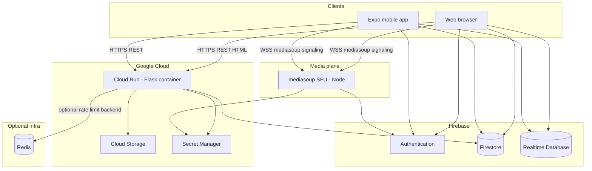

# Divine Bridge — Full application architecture

This document describes how the product is structured across **web**, **mobile**, **backend**, **realtime data**, **live media (WebRTC)**, and **email**. It complements user-facing behavior in [USER_FEATURES_DOCUMENTATION.md](USER_FEATURES_DOCUMENTATION.md) and deployment details under [deployment/](deployment/).

**Last updated:** March 2026

---

## Terminology: “calling” and “texting”

| Term in this doc | What the codebase implements |
|------------------|-------------------------------|
| **Live calling (voice/video)** | **WebRTC** audio/video routed through a **mediasoup** Selective Forwarding Unit (SFU). This is **not** PSTN telephone calling. |
| **Text chat** | **In-app messaging** stored in **Firebase Firestore** and/or delivered with **Firebase Realtime Database (RTDB)** for low-latency live-room UX. |
| **SMS / carrier texting** | **Not implemented** in this repository (no Twilio or similar SMS integration). User profiles may store a **phone number** for display or vCard-style export only. |

A short **Future / not implemented** note: PSTN dial-in or outbound SMS would be new integrations and are not part of the current architecture.

---

## Languages and runtimes

| Layer | Languages / tooling | Primary locations |
|-------|---------------------|-------------------|
| Main API and server-rendered web | Python 3.8+, Flask, Jinja2, CSS, vanilla JavaScript | [app.py](../app.py), [backend/api/](../backend/api/), [web/templates/](../web/templates/), [web/static/](../web/static/) |
| Live media SFU | Node.js (≥18), JavaScript | [media-server/](../media-server/) |
| Browser mediasoup bundle | JavaScript (esbuild) | [web/client/](../web/client/) → [web/static/js/sfu-bundle.js](../web/static/js/sfu-bundle.js) |
| Mobile app | TypeScript / TSX, React Native (Expo ~54) | [mobile/](../mobile/) |
| Protocol fixtures | JSON contracts | [contracts/](../contracts/) |

---

## High-level system diagram

**Traffic summary**

- **Application API and pages:** Browsers and the mobile app call the Flask origin (production: `https://divinebridge.io`) for REST, session-backed pages, and JSON APIs under `/api/...`.
- **Realtime state:** Clients use the **Firebase JS SDK** (web) and **Firebase** package (mobile) for **Firestore** and **RTDB** where features require sync (live rooms, chat, groups, etc.).
- **Media:** WebRTC transports connect to a **separate SFU** process. Production WebSocket URL is configured as `wss://sfu.divinebridge.io/ws` in [mobile/lib/constants.ts](../mobile/lib/constants.ts) and [web/static/js/sfu-client.js](../web/static/js/sfu-client.js).

---

## Backend (Flask)

### Entry and cross-cutting concerns

- **Factory and HTTP app:** [app.py](../app.py) builds the Flask app, registers blueprints, configures sessions, CSRF ([Flask-WTF](https://flask-wtf.palletsprojects.com/)), CORS, and security headers (CSP, HSTS in production, `Permissions-Policy` for microphone/camera on prayer experiences). [backend/wsgi.py](../backend/wsgi.py) is the canonical WSGI import; `app.py` remains the compatibility entry point during the incremental migration.
- **Sessions:** [Flask-Session](https://flask-session.readthedocs.io/) with filesystem storage; production uses secure cookie flags.
- **Rate limiting:** [Flask-Limiter](https://flask-limiter.readthedocs.io/) with **Redis** when `REDIS_HOST` is reachable, otherwise in-memory ([app.py](../app.py)).
- **Firebase Admin:** Initialized at startup ([firebase_auth.py](../firebase_auth.py)); used for Firestore, custom claims, and token verification patterns across routes.

### Realtime over HTTP

- **Flask-SocketIO** is initialized in [app.py](../app.py) (`async_mode='threading'`). The **live prayer room web client** intentionally **prefers Firebase RTDB plus HTTP** for much of its realtime behavior rather than depending on Socket.IO ([web/static/js/prayer-room.js](../web/static/js/prayer-room.js)). Socket.IO remains available for other or legacy paths.

### API surface (blueprints)

Canonical implementations live under [backend/api/](../backend/api/) and are registered in [app.py](../app.py). Contract fixtures in [contracts/](../contracts/) guard the public URL surface.

| Prefix / area | Blueprint module | Role (summary) |
|---------------|------------------|----------------|
| `/api/auth` | [backend/api/auth_bp.py](../backend/api/auth_bp.py) | Login, registration, profile, tokens |
| `/api/prayer` | [backend/api/prayer_bp.py](../backend/api/prayer_bp.py) | Prayer requests, daily content interactions |
| `/api` | [backend/api/verse_bp.py](../backend/api/verse_bp.py) | Today’s verse, downloads, likes/shares |
| `/api/nonprofit` | [backend/api/nonprofit_bp.py](../backend/api/nonprofit_bp.py) | Organization network |
| `/api/email` | [backend/api/email_bp.py](../backend/api/email_bp.py) | Subscriptions and related email flows |
| `/api/testimony` | [backend/api/testimony_bp.py](../backend/api/testimony_bp.py) | Thanksgiving wall / testimonies |
| `/api/prayer-room` | [backend/api/prayer_room/](../backend/api/prayer_room/) | Live rooms, Voice Link, SFU tokens, scheduled rooms, chat |
| `/api/devotional` | [backend/api/devotional_bp.py](../backend/api/devotional_bp.py) | AI-generated devotional plans |
| `/api/groups` | [backend/api/groups_bp.py](../backend/api/groups_bp.py) | Prayer groups CRUD and membership |
| Admin, SEO | [backend/api/admin_bp.py](../backend/api/admin_bp.py), [backend/api/seo/](../backend/api/seo/) | Operations and public SEO/disaster pages |
| HTML pages | [backend/web/](../backend/web/) | Server-rendered marketing/auth/room pages |

### Domain services (Python modules)

Business logic lives under [backend/services/](../backend/services/) (prayer, verse, email, disaster, community, media). Local development can swap storage via `USE_LOCAL_STORAGE=true` and [backend/integrations/local_storage.py](../backend/integrations/local_storage.py).

### Email

- **SMTP:** [app.py](../app.py) configures Gmail SMTP (`smtp.gmail.com`, port 587) and sender identity; [backend/api/email_bp.py](../backend/api/email_bp.py) implements subscription and related endpoints.
- **Scheduled jobs:** Described in [deployment/CLOUD_SCHEDULER_SETUP.md](deployment/CLOUD_SCHEDULER_SETUP.md) (daily prayer generation, reminders, etc.).

---

## Web frontend

### Server-rendered UI

- **Templates:** [web/templates/](../web/templates/) (Jinja2) for marketing, prayer room pages, auth pages, and SEO-oriented routes.
- **Static assets:** [web/static/](../web/static/) — CSS, images, shared JS.

### Live prayer room (browser)

- **Orchestration:** [web/static/js/prayer-room.js](../web/static/js/prayer-room.js) — room UI, participant state, microphone flows, integration with **RTDB** and **Firestore** for chat and signaling-style updates, and REST calls to `/api/prayer-room/...`.
- **SFU client:** [web/static/js/sfu-client.js](../web/static/js/sfu-client.js) uses **mediasoup-client** loaded from [web/static/js/sfu-bundle.js](../web/static/js/sfu-bundle.js) (built from [web/client/](../web/client/)). The file header states protocol parity with [mobile/lib/sfu.ts](../mobile/lib/sfu.ts). Protocol fixture: [contracts/sfu-protocol.json](../contracts/sfu-protocol.json).

### Room modes (aligned with mobile)

Constants in [mobile/lib/constants.ts](../mobile/lib/constants.ts): **group call** (small participant cap, full mesh-style media expectations) vs **prayer room** (larger gatherings, speaker caps, spotlight video semantics). Web and mobile are intended to follow the same SFU protocol and caps.

---

## Mobile app (Expo / React Native)

### Navigation

- **expo-router** file-based routes under [mobile/app/](../mobile/app/): tab shell (home, devotional, groups, rooms, profile), auth routes under `(auth)/`, live room `room/[id]`, group `group/[id]`, and [mobile/app/activity.tsx](../mobile/app/activity.tsx).

### Data and auth

- **Firebase:** [mobile/lib/firebase.ts](../mobile/lib/firebase.ts) exposes Firestore (and the app uses other Firebase surfaces as needed).
- **REST API:** [mobile/lib/constants.ts](../mobile/lib/constants.ts) sets `API_BASE_URL` (production `https://divinebridge.io`).
- **Session bridge:** After Firebase signup, [mobile/lib/backendAuth.ts](../mobile/lib/backendAuth.ts) POSTs an **ID token** to `/api/auth/login` so server-side profile creation matches web registration behavior.

### State and UI

- **TanStack Query** and **Zustand** ([mobile/package.json](../mobile/package.json)) for server state and local UI state.
- **Styling:** NativeWind / Tailwind-style utilities.

### Live media

- **react-native-webrtc** and **mediasoup-client** — implementation in [mobile/lib/sfu.ts](../mobile/lib/sfu.ts).
- **Audio routing:** [mobile/lib/liveRoomAudio.ts](../mobile/lib/liveRoomAudio.ts) (e.g. speaker vs earpiece with `react-native-incall-manager`).
- **Hooks:** [mobile/hooks/usePrayerRoom.ts](../mobile/hooks/usePrayerRoom.ts) and related hooks tie UI to Firestore/RTDB and room APIs.

### Groups chat (Firestore)

- [mobile/hooks/useGroups.ts](../mobile/hooks/useGroups.ts) reads/writes subcollections under `group_chat_messages/{groupId}/messages` (see `COLLECTIONS` in [mobile/lib/constants.ts](../mobile/lib/constants.ts)).

---

## Media server (SFU)

- **Stack:** Express HTTP server, **WebSocket** signaling, **mediasoup** workers ([media-server/src/server.js](../media-server/src/server.js)).
- **Rooms:** In-memory registry of mediasoup `Room` / `Peer` objects; JSON request/response protocol over WebSocket (`join`, transports, producers, consumers, etc.).
- **Auth:** [media-server/src/auth.js](../media-server/src/auth.js) verifies **Firebase ID tokens** using the same credential sources as Flask (Secret Manager secret `FIREBASE_CREDENTIALS`, ADC, or local key file). Development can use `DEV_MODE` / base64-encoded JSON “tokens” for local testing.

---

## Data model (conceptual)

Authoritative security rules: [firestore.rules](../firestore.rules). Below is a **conceptual** list of collections and purposes (field-level schemas belong in code and rules).

| Area | Firestore (typical) | Notes |
|------|---------------------|--------|
| Users | `users` | Profile, preferences, admin flags |
| Live rooms | `prayer_rooms`, `scheduled_rooms`, `scheduled_room_rsvps` | Room metadata, scheduling, RSVPs |
| Chat | `chat_messages`, `group_chat_messages/{id}/messages` | Room chat and group chat ([backend/api/prayer_room/](../backend/api/prayer_room/), [mobile/features/groups/hooks/useGroups.ts](../mobile/features/groups/hooks/useGroups.ts)) |
| Community | `prayer_groups`, `group_members` | Small groups ([backend/api/groups_bp.py](../backend/api/groups_bp.py)) |
| Content | `prayer_requests`, `private_prayer_requests`, `testimonies` | Public Prayer Wall (GCS-backed in production), private leader-matched prayer requests, and thanksgiving wall |
| Devotionals | `devotional_plans` | Personalized plans ([backend/api/devotional_bp.py](../backend/api/devotional_bp.py)) |
| Devotional templates | `devotional_templates` | Pre-generated plans for the 8 suggested themes × 3 durations (7/14/30 days). Backend-only (no client access). Keyed by `{theme-slug}_{duration}` (e.g. `faith-trust_7`). Refreshed monthly via `/admin/api/refresh-devotional-templates` or `scripts/maintenance/pregen_devotional_templates.py`. |
| Verse devotional context | `verse_contexts` | AI-generated short "sermon" for each daily verse. Keyed by verse slug (e.g. `1-john-4-11`), not date. Writes via [backend/services/verse/verse_context_generator.py](../backend/services/verse/verse_context_generator.py) from [backend/api/verse_bp.py](../backend/api/verse_bp.py) or `scripts/maintenance/pregen_verse_contexts.py`. |

**Firebase Realtime Database** is used for **low-latency** live-room concerns on the web client (and related mobile hooks) — paths are managed in client code (e.g. [web/static/js/prayer-room.js](../web/static/js/prayer-room.js)).

**Private prayer matching:** `private_prayer_requests` is server-only in Firestore. Trusted server/admin tooling grants a leader `is_prayer_leader: true` and `prayer_languages: string[]`; mobile profile writes cannot modify either field. Requests expire after 48 hours, the first eligible leader claims through a Firestore transaction, requesters can cancel an active/claimed/scheduled request, and authorized participants can record an anonymous prayer count.

**Object storage:** User-generated and generated assets (e.g. images) via [backend/integrations/storage_handler.py](../backend/integrations/storage_handler.py) to **Google Cloud Storage**.

---

## Deployment and operations

- **Flask container:** [Dockerfile](../Dockerfile) builds the main app; [cloud-run-config.yaml](../cloud-run-config.yaml) sketches a Cloud Run service (port **8080**, health checks on `/_ah/health`).
- **SFU:** Deployed as a **separate** Node service (not the Flask container); scales and networking differ from the HTTP API.
- **CI/CD:** [.github/workflows/deploy.yml](../.github/workflows/deploy.yml); narrative docs: [deployment/DEPLOYMENT_GUIDE.md](deployment/DEPLOYMENT_GUIDE.md), [deployment/DEPLOY_PIPELINE.md](deployment/DEPLOY_PIPELINE.md).

Follow team process: review changes and deployment history before promoting to production (see repository guidelines).

---

## Feature index (code entry points)

User journeys and screenshots-level detail: **[USER_FEATURES_DOCUMENTATION.md](USER_FEATURES_DOCUMENTATION.md)**.

| Feature area | Main code / doc pointers |
|--------------|---------------------------|
| Daily prayer and AI generation | [backend/services/prayer/prayer_generator.py](../backend/services/prayer/prayer_generator.py), [backend/api/prayer_bp.py](../backend/api/prayer_bp.py), scheduler docs [deployment/CLOUD_SCHEDULER_SETUP.md](deployment/CLOUD_SCHEDULER_SETUP.md) |
| Daily verse | [backend/api/verse_bp.py](../backend/api/verse_bp.py), [backend/services/verse/](../backend/services/verse/) |
| Verse devotional context | [backend/services/verse/verse_context_generator.py](../backend/services/verse/verse_context_generator.py), [backend/api/verse_bp.py](../backend/api/verse_bp.py), [scripts/maintenance/pregen_verse_contexts.py](../scripts/maintenance/pregen_verse_contexts.py), [mobile/app/verse-reader.tsx](../mobile/app/verse-reader.tsx) |
| Verse explainer share cards | Four themed 9:16 JPEGs (verse, context, meaning, application) from [backend/services/prayer/image_generator.py](../backend/services/prayer/image_generator.py) via `GET /api/today-verse/explainer-image/<section>`. Cached in GCS by verse slug. Opened from the verse-reader share button. |
| Disaster / SEO pages | [backend/api/seo/](../backend/api/seo/), [backend/services/disaster/](../backend/services/disaster/) |
| Prayer requests | [backend/api/prayer_bp.py](../backend/api/prayer_bp.py), [backend/services/prayer/content_moderator.py](../backend/services/prayer/content_moderator.py) |
| Private prayer matching | [backend/services/prayer/private_prayer_request_service.py](../backend/services/prayer/private_prayer_request_service.py), [backend/api/prayer_bp.py](../backend/api/prayer_bp.py), [mobile/app/prayer-requests.tsx](../mobile/app/prayer-requests.tsx) |
| Testimonies | [backend/api/testimony_bp.py](../backend/api/testimony_bp.py) |
| Live prayer room (web) | [web/static/js/prayer-room.js](../web/static/js/prayer-room.js), [web/static/js/sfu-client.js](../web/static/js/sfu-client.js) |
| Live room (mobile) | [mobile/app/room/[id].tsx](../mobile/app/room/[id].tsx), [mobile/lib/sfu.ts](../mobile/lib/sfu.ts), [mobile/hooks/usePrayerRoom.ts](../mobile/hooks/usePrayerRoom.ts) |
| Groups | [backend/api/groups_bp.py](../backend/api/groups_bp.py), [mobile/app/(tabs)/groups.tsx](../mobile/app/(tabs)/groups.tsx), [mobile/app/group/[id].tsx](../mobile/app/group/[id].tsx) |
| Devotional plans | [backend/api/devotional_bp.py](../backend/api/devotional_bp.py), [mobile/app/(tabs)/devotional.tsx](../mobile/app/(tabs)/devotional.tsx) |
| Auth and profile | [backend/api/auth_bp.py](../backend/api/auth_bp.py), [backend/integrations/firebase_auth.py](../backend/integrations/firebase_auth.py), [mobile/app/(auth)/](../mobile/app/(auth)/) |
| Email subscriptions | [backend/api/email_bp.py](../backend/api/email_bp.py), [guides/EMAIL_CONFIGURATION_GUIDE.md](guides/EMAIL_CONFIGURATION_GUIDE.md) |
| Organizations / nonprofits | [backend/api/nonprofit_bp.py](../backend/api/nonprofit_bp.py), [backend/services/community/nonprofit_service.py](../backend/services/community/nonprofit_service.py) |
| Admin | [backend/api/admin_bp.py](../backend/api/admin_bp.py) |
| Media SFU | [media-server/src/server.js](../media-server/src/server.js), [media-server/src/auth.js](../media-server/src/auth.js) |

---

## Related documentation

- [docs/README.md](README.md) — documentation index  
- [deployment/DEPLOYMENT_GUIDE.md](deployment/DEPLOYMENT_GUIDE.md)  
- [guides/QUICKSTART_TESTING.md](guides/QUICKSTART_TESTING.md)  
- [guides/TURN_SERVER_SETUP.md](guides/TURN_SERVER_SETUP.md) — WebRTC TURN (if configured for your environment)  
